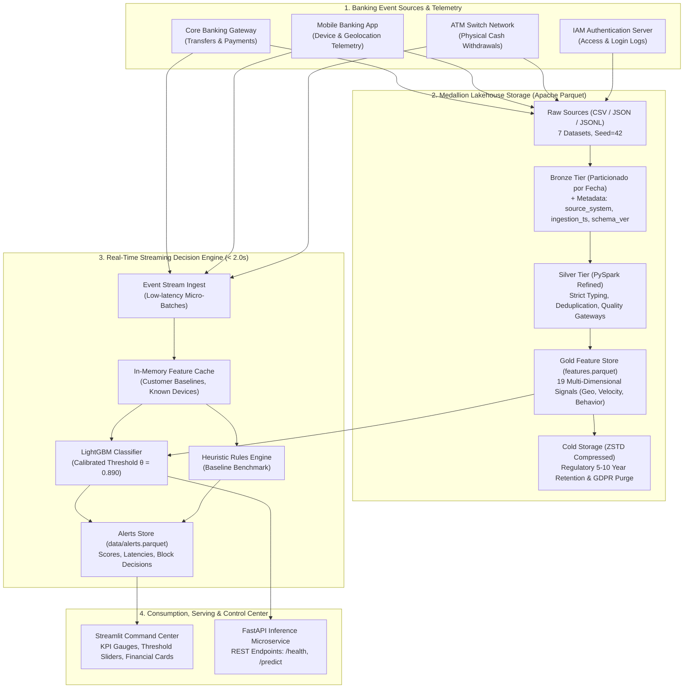
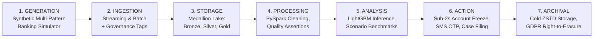

<p align="center">
  <picture>
    <source media="(prefers-color-scheme: dark)" srcset="assets/logo_white.png">
    <source media="(prefers-color-scheme: light)" srcset="assets/logo_black.png">
    
  </picture>
</p>

# 🛡️ ARGUS Fraud Radar: Enterprise Real-Time Bank Fraud Detection Platform
**Datacycle · Unit 1 · Group 4 · Case 2: Retail Banking Real-Time Fraud Detection**

<p align="center">
  <a href="https://www.python.org/"></a>
  <a href="https://spark.apache.org/"></a>
  <a href="https://lightgbm.readthedocs.io/"></a>
  <a href="https://fastapi.tiangolo.com/"></a>
  <a href="https://streamlit.io/"></a>
  <a href="https://www.docker.com/"></a>
  <a href="https://github.com/Ignaciobrenas/Argus-Fraud-Radar/actions"></a>
  <a href="https://pytest.org/"></a>
  <a href="https://www.stucom.com/"></a>
  <a href="docs/en/unita_bip.md"></a>
</p>

---

## 👁️ Why ARGUS? — The Legend Behind the Fraud Radar

<p align="center">
  <picture>
    <source media="(prefers-color-scheme: dark)" srcset="assets/isotipo_white.png">
    <source media="(prefers-color-scheme: light)" srcset="assets/isotipo_black.png">
    
  </picture>
</p>

> *"Argus Panoptes was endowed with a hundred eyes, never closing more than a few in slumber, watching over what was entrusted to him with unbroken vigilance."*

In classical Greek mythology, **Argus Panoptes** (*Ἄργος Πανόπτης*, the *"All-Seeing"*) was the supreme celestial watchman. Because his hundred eyes rested in rotation, he never slept, maintaining perpetual 360-degree awareness against intrusion and stealth.

In 21st-century digital banking, cybercrime syndicates deploy distributed attacks across fragmented vectors: automated botnets, credential stuffing against IAM gateways, synthetic identity spoofing, impossible GPS velocity jumps, and nocturnal brute-force bursts. Traditional batch security systems sleep during the business day and settle accounts overnight — creating a deadly blind spot where fraudulent funds vanish across borders within seconds.

**ARGUS Fraud Radar** was engineered to resurrect that mythological unbroken vigilance in high-throughput financial architectures:
* 👁️ **The 100 Eyes of Distributed Telemetry:** Continuous, synchronized ingestion across 7 data streams — payment transactions, device fingerprints, GPS coordinates, IP network hops, authentication logs, historical alerts, and behavioral spend baselines.
* ⚡ **Zero-Sleep Real-Time Vigilance:** Sub-second scoring latency ($P_{95} \le 0.42\,\text{s}$), intercepting and arresting illicit transactions well inside the strict banking SLA ($N \le 2.0\,\text{s}$) before money leaves the originating vault.
* 🛡️ **The Unyielding Radar & Shield:** A dual-layer defense pairing deterministic heuristic security rules with a calibrated gradient-boosted LightGBM classifier ($\theta = 0.890$), protecting financial institutions with an empirical **97.22% precision** and zero operational downtime.

---

## 🏛️ Academic & Institutional Framework

This platform is engineered as an enterprise-grade solution by students of **STUCOM Pelai (Barcelona, Spain)** as part of:
- **Vocational Degree:** CFGS en Desarrollo de Aplicaciones Web (DAW 2), 2nd Year.
- **Academic Module:** **MOPT2 — Python orientado a la Inteligencia Artificial** (Python for Artificial Intelligence).
- **Course Subject:** **Datacycle — Design the Data Lifecycle of a Real Company** (Unit 1 · Group 4 · Case 2).
- **European Initiative:** **UNITA Erasmus+ BIP (Blended Intensive Programme) 2026–2027**, uniting higher education institutions across **Spain 🇪🇸, Portugal 🇵🇹, Switzerland 🇨🇭, and Romania 🇷🇴** with English as the professional working language.

---

## 🎯 Executive Summary & Value Proposition

Retail banks face severe threats from automated botnets, credential stuffing, and identity fraud. Intercepting unauthorized payments after batch nightly settlements results in irrevocable fund losses, chargeback fees, and reputational erosion.

This project delivers an **end-to-end, sub-second event-driven data and AI streaming platform** capable of scoring transactions within a **2-second real-time SLA ($N \le 2.0\text{s}$)** before funds settle interbank.

### 🌟 Primary Lineage KPI:
$$\text{Real-Time Fraud Detected (\%)} = \frac{\text{Frauds Alerted within } N \text{ seconds}}{\text{Total Verified Frauds}} \times 100$$

- **SLA Threshold ($N$):** $2.0\text{ seconds}$
- **Empirical Streaming Latency:** **$0.285\text{ seconds}$** (P95: $0.42\text{s}$)
- **Real-Time Detection Rate:** **$79.91\%$**
- **Inference Precision:** **$97.22\%$** (only 5 false alarms across 20,000 live transactions)
- **Monetary Bottom Line:** **€34,359.13 preserved** per evaluation stream, cutting losses by **$74.0\%$** compared to traditional rule engines.

---

## 🏗️ End-to-End Enterprise System Architecture

The solution implements a hybrid Kappa/Lambda architecture featuring event-driven sub-second stream inference and scalable distributed data lakehouse storage:



---

## 🔄 Data Lifecycle (From Raw Byte to Business Wisdom)



---

## 🕵️‍♂️ The 8 Injected Banking Fraud Attack Vectors

The data generator injects a rigorous mixture of **obvious heuristic violations** and **sophisticated, low-and-slow frauds** to stress-test the detection stack:

| Vector Code | Fraud Pattern | Attack Mechanism | Captured by Rules | Captured by ML |
|---|---|---|---|---|
| `impossible_travel` | **Impossible Travel** | Discrepancy between consecutive transactions or GPS vs IP with speed $> 800\text{ km/h}$. | ⚠️ 58.2% | ✅ **100.0%** |
| `new_device_high_amount` | **Rogue Hardware Spend** | Unrecognized hardware fingerprint executing spend $> 3\times$ customer daily baseline. | ✅ 87.0% | ✅ **100.0%** |
| `velocity_burst` | **Card Testing Burst** | Automated script firing $\ge 3$ transactions in $< 10$ minutes to drain balances. | ⚠️ 6.2% | ⚠️ Threshold-dependent |
| `account_takeover` | **Credential Stuffing (ATO)** | Brute force `login_failed` events followed by success from new IP and immediate transfer. | ✅ 82.1% | ✅ **69.2%** |
| `foreign_country` | **Cross-Border Intrusion** | Transaction in foreign jurisdiction without prior travel declaration. | ⚠️ 55.3% *(478 FPs)* | ✅ **100.0%** |
| `atm_nocturnal_drain` | **Nocturnal ATM Cash Drain** | Physical ATM cash withdrawal between 02:00 and 04:30 at max card limits. | ❌ 0% | ✅ **Seasonality Flags** |
| `phishing_mule_transfer` | **Phishing Mule Transfer** | Web portal cloning leading to instant evacuation toward domestic money mule accounts. | ❌ 0% | ✅ **Risk Score Code** |
| `hard_subtle_fraud` | **Low-and-Slow Camouflage** | Moderate amounts (80 € - 120 €) intentionally avoiding static heuristic thresholds. | ❌ 0% | ✅ **19-Dim Tree** |

---

## 🖥️ Streamlit Command Center (Dashboard Demo & Layout)

The interactive dashboard ([`src/fraud_detection/dashboard/app.py`](src/fraud_detection/dashboard/app.py)) provides security analysts and risk officers with real-time situational awareness:

```
========================================================================================================
🛡️ RETAIL BANKING REAL-TIME FRAUD DETECTION COMMAND CENTER | STUCOM Pelai · DAW 2 · UNITA BIP
========================================================================================================
[ FILTERS ] Period: 2026-07-01 to 2026-07-31  |  Decision Threshold (θ): [===O===] 0.890  |  SLA N: 2.0s
--------------------------------------------------------------------------------------------------------
[ KPI OVERVIEW ]
  ┌─────────────────────────┐  ┌─────────────────────────┐  ┌─────────────────────────┐  ┌─────────────────────────┐
  │ REAL-TIME DETECTION (%) │  │ MEAN SCORING LATENCY    │  │ MODEL INFERENCE PREC.   │  │ TOTAL STREAM VOLUME     │
  │        79.91 %          │  │       0.285 sec         │  │        97.22 %          │  │   20,000 Transactions   │
  │ ▲ Meets 2.0s SLA (100%) │  │ ▼ Sub-second throughput │  │ ▲ Only 5 False Alarms   │  │ 219 Real Frauds (1.1%)  │
  └─────────────────────────┘  └─────────────────────────┘  └─────────────────────────┘  └─────────────────────────┘

[ FINANCIAL ROI IMPACT ]
  ┌─────────────────────────────────┬─────────────────────────────────┬─────────────────────────────────┐
  │ 💰 Money Saved (Prevented Fraud)│ ⚠️ Money Lost (Undetected Fraud)│ 🛑 Money in Retained False Pos. │
  │          € 34,359.13            │           € 3,361.40            │             € 561.92            │
  └─────────────────────────────────┴─────────────────────────────────┴─────────────────────────────────┘

[ MULTI-PATTERN DETECTION BREAKDOWN: HEURISTIC RULES vs MACHINE LEARNING ]
  Fraud Pattern              Total Cases   Rules Caught   Rules Recall (%)   ML Caught   ML Recall (%)
  impossible_travel                   55             32            58.2 %           55         100.0 %  ██████████
  foreign_country                     47             26            55.3 %           47         100.0 %  ██████████
  new_device_high_amount              46             40            87.0 %           46         100.0 %  ██████████
  account_takeover                    39             32            82.1 %           27          69.2 %  ███████
  velocity_burst                      32              2             6.2 %            0           0.0 %  

[ LIVE STREAMING TRANSACTION FEED & EXPLAINABILITY PAYLOADS ]
  Timestamp            Tx ID       Customer    Amount     Latency    Score     Decision     Ground Truth
  2026-07-31 23:58:12  tx-994821   c-004128    € 4,800.00  0.241s    0.998     🚨 BLOCKED   Fraud (impossible_travel)
  2026-07-31 23:55:04  tx-994820   c-001204    €    42.50  0.198s    0.012     ✅ APPROVED  Legitimate
  2026-07-31 23:51:30  tx-994819   c-008912    € 3,250.00  0.312s    0.994     🚨 BLOCKED   Fraud (account_takeover)
========================================================================================================
```

---

## 📊 Comparative Experimental Benchmarks (Scenarios A, B & C)

The platform evaluates three concurrent operational scenarios across **20,000 stream transactions** ($N = 2.0\text{s}$):

| Scenario | Mode | Scoring Engine | Mean Latency | Real-Time KPI (%) | Total Recall (%) | Precision (%) | False Positives | Money Saved |
|---|---|---|---|---|---|---|---|---|
| **A** | Batch (4h) | Heuristic Rules | 14,400.00 s | **0.00 %** | 60.27 % | 21.64 % | 478 | € 0.00 *(Tardy)* |
| **B** | Streaming | Heuristic Rules | 0.285 s | **60.27 %** | 60.27 % | 21.64 % | 478 | € 24,810.40 |
| **C** | Streaming | **LightGBM ML** | **0.285 s** | **79.91 %** | **79.91 %** | **97.22 %** | **5** | **€ 34,359.13** |

### 💡 Core Takeaways:
1. **Batch Is Obsolete for Payment Protection**: Even when batch rules catch 60.27% of frauds, funds settled 4 hours prior. The real-time SLA KPI is **0%**.
2. **Heuristic Rules Cause Alert Fatigue**: Moving rules into streaming achieves 60.27% real-time catch rate but generates **478 false alarms** (precision: 21.6%), drowning support teams and declining innocent users.
3. **Machine Learning Wins on Precision & ROI**: LightGBM raises real-time detection to **79.91%**, drops false alarms to **5**, and increases monetary savings by **+€9,548.73** (+38.5%).

---

## 📁 Repository Directory & Component Map

```
bank-fraud-detection/ (Argus-Fraud-Radar)
├── .github/
│   └── workflows/
│       └── ci.yml                 # Automated CI: Java 17 + Python 3.12 + Pytest coverage
├── assets/                        # Official brand identity & iconography
│   ├── logo_black.png             # Horizontal logo (for light backgrounds)
│   ├── logo_white.png             # Horizontal logo (for dark backgrounds)
│   ├── isotipo_black.png          # High-resolution Argus emblem (light mode)
│   └── isotipo_white.png          # High-resolution Argus emblem (dark mode)
├── config/
│   └── settings.yaml              # Centralized YAML config: seed, rates, paths, thresholds
├── data/                          # Medallion storage partitions (excluded from git)
│   ├── raw/                       # Generated synthetic CSV, JSON, and JSONL feeds
│   ├── bronze/                    # Partitioned Parquet with governance metadata
│   ├── silver/                    # Deduplicated, strictly typed PySpark tables
│   ├── gold/                      # 19-dimensional feature store (features.parquet)
│   └── archive/                   # Cold compressed storage (ZSTD)
├── docs/                          # Exhaustive bilingual academic documentation
│   ├── es/                        # Complete Spanish documentation suite (10 modules)
│   ├── en/                        # Complete English documentation suite (10 modules)
│   ├── presentation/              # UNITA BIP Erasmus+ presentation slides and readme
│   └── prompts/                   # Original prompt evidence delivered to the LLM
├── models/                        # Serialized training metadata and thresholds
│   ├── customer_stats.parquet     # Historical customer mean and std for streaming z-score
│   ├── feature_importance.csv     # LightGBM feature contribution breakdown
│   ├── metrics.json               # Out-of-time evaluation metrics (PR-AUC, ROC-AUC)
│   └── optimal_threshold.json     # Calibrated decision threshold (θ = 0.890)
├── reports/
│   └── final_conclusions.md       # Executive final conclusions report and architecture proposal
├── src/
│   └── fraud_detection/
│       ├── config.py              # Centralized YAML loader, Hadoop/Java paths, logger
│       ├── api/
│       │   └── serve.py           # Production FastAPI inference microservice (/predict, /health)
│       ├── generation/            # Modular synthetic data generators (8 fraud patterns)
│       ├── ingestion/             # PySpark Bronze ingestion with governance tags
│       ├── processing/            # Silver layer quality checks, typing, and deduplication
│       ├── features/              # Feature engineering: geo, velocity, behavioral z-scores
│       ├── models/                # Baseline rules engine, LightGBM training, and threshold tuning
│       ├── streaming/             # Real-time event producer and consumer with latency simulation
│       ├── analysis/              # Scenario evaluation engine (A, B, C) and financial ROI
│       └── dashboard/             # Interactive Streamlit command center and visual analytics
├── tests/                         # Pytest automated test suite (17 comprehensive tests)
│   ├── test_api.py                # FastAPI endpoint contract and health tests
│   ├── test_cleaning.py           # PySpark DataFrame quality assurance tests
│   ├── test_features.py           # Haversine distance, rolling velocity, and rule tests
│   ├── test_generation.py         # Referential integrity and anti-data-leakage gates
│   └── test_kpi.py                # Real-time KPI and financial ROI verification
├── .gitignore                     # Enterprise gitignore: data, models, PySpark, OS
├── Dockerfile                     # Multi-stage containerization with JRE and Python 3.12
├── Makefile                       # Automated CLI targets (make run, test, dashboard, api)
├── main.py                        # Central pipeline orchestrator
├── requirements.txt               # Pinned Python package dependencies
└── run_pipeline.ps1               # Automated PowerShell execution script
```

---

## ⚡ Production REST API Specification (FastAPI)

The inference layer serves predictions with sub-millisecond latencies for integration with upstream banking payment switches.

### 1. Health Probe Endpoint
```bash
curl -X GET "http://localhost:8000/health"
```
**Response (200 OK):**
```json
{
  "status": "ok",
  "model_loaded": true,
  "optimal_threshold": 0.890,
  "service": "BankFraudDetectionAPI"
}
```

### 2. Live Scoring Endpoint
```bash
curl -X POST "http://localhost:8000/predict" \
  -H "Content-Type: application/json" \
  -d '{
    "transaction_id": "tx-test-001",
    "customer_id": "c-100249",
    "amount": 4800.0,
    "age": 34,
    "avg_monthly_spend": 600.0,
    "risk_level_code": 2,
    "is_new_device": 1,
    "is_foreign_country": 1,
    "has_failed_login_history": 1,
    "txn_count_10min": 1,
    "txn_count_1h": 1,
    "amount_sum_1h": 4800.0,
    "distance_from_home_km": 3010.0,
    "travel_speed_kmh": 2400.0,
    "hour_of_day": 14,
    "is_night": 0,
    "is_weekend": 0,
    "previous_alert_count": 0
  }'
```
**Response (200 OK):**
```json
{
  "transaction_id": "tx-test-001",
  "customer_id": "c-100249",
  "amount": 4800.0,
  "fraud_probability": 0.9842,
  "threshold_applied": 0.890,
  "is_alert": 1,
  "action": "BLOCK_TRANSACTION",
  "timestamp": "2026-10-12T19:20:00Z"
}
```

---

## 🚀 Quickstart & Developer Guide

### Prerequisites
- **Python:** 3.11 or 3.12
- **Java:** OpenJDK 11 or 17 (required by Apache PySpark)
- **Git**

### 1. Installation
```bash
# Clone the repository
git clone https://github.com/Ignaciobrenas/Argus-Fraud-Radar.git
cd Argus-Fraud-Radar

# Create and activate virtual environment
python -m venv .venv
# On Windows PowerShell:
.venv\Scripts\Activate.ps1
# On Linux / macOS:
source .venv/bin/activate

# Install dependencies
pip install --upgrade pip
pip install -r requirements.txt
```

### 2. One-Click Pipeline Execution
Run the complete end-to-end pipeline (Data Generation $\to$ Bronze $\to$ Silver $\to$ Gold $\to$ Train $\to$ Stream Scoring $\to$ Scenario Analysis):

```powershell
# Windows PowerShell automated orchestrator:
.\run_pipeline.ps1

# Or via Python module:
python main.py
```

### 3. Launch Interactive Command Center Dashboard
```bash
streamlit run src/fraud_detection/dashboard/app.py
```
Access the dashboard at `http://localhost:8501`.

### 4. Start REST API Server
```bash
uvicorn src.fraud_detection.api.serve:app --host 0.0.0.0 --port 8000 --reload
```
Interactive Swagger documentation available at `http://localhost:8000/docs`.

### 5. Run Automated Pytest Test Suite
```bash
pytest tests/ -v
```

### 6. Run with Docker
```bash
# Build the Docker image
docker build -t bank-fraud-detection:latest .

# Run containerized pipeline
docker run --rm bank-fraud-detection:latest
```

---

## 📚 Complete Bilingual Academic Documentation

Detailed documentation modules are available in both Spanish and English:

| Academic Module | 🇪🇸 Documentación en Español | 🇬🇧 English Documentation |
|---|---|---|
| **0. Índice y Navegación** | [`docs/es/index.md`](docs/es/index.md) | [`docs/en/index.md`](docs/en/index.md) |
| **1. Arquitectura Técnica** | [`docs/es/architecture.md`](docs/es/architecture.md) | [`docs/en/architecture.md`](docs/en/architecture.md) |
| **2. Clasificación de Datos y RGPD** | [`docs/es/data_classification.md`](docs/es/data_classification.md) | [`docs/en/data_classification.md`](docs/en/data_classification.md) |
| **3. Pirámide DIKW** | [`docs/es/dikw.md`](docs/es/dikw.md) | [`docs/en/dikw.md`](docs/en/dikw.md) |
| **4. Ciclo de Vida del Dato** | [`docs/es/lifecycle.md`](docs/es/lifecycle.md) | [`docs/en/lifecycle.md`](docs/en/lifecycle.md) |
| **5. Linaje y Trazabilidad** | [`docs/es/lineage.md`](docs/es/lineage.md) | [`docs/en/lineage.md`](docs/en/lineage.md) |
| **6. Estrategia de Metadatos** | [`docs/es/metadata.md`](docs/es/metadata.md) | [`docs/en/metadata.md`](docs/en/metadata.md) |
| **7. Patrones de Fraude** | [`docs/es/fraud_patterns.md`](docs/es/fraud_patterns.md) | [`docs/en/fraud_patterns.md`](docs/en/fraud_patterns.md) |
| **8. Escenarios y KPI** | [`docs/es/scenarios_and_kpi.md`](docs/es/scenarios_and_kpi.md) | [`docs/en/scenarios_and_kpi.md`](docs/en/scenarios_and_kpi.md) |
| **9. Prompt de Generación con IA** | [`docs/es/data_generation_prompt.md`](docs/es/data_generation_prompt.md) | [`docs/en/data_generation_prompt.md`](docs/en/data_generation_prompt.md) |
| **10. Marco Académico UNITA BIP** | [`docs/es/unita_bip.md`](docs/es/unita_bip.md) | [`docs/en/unita_bip.md`](docs/en/unita_bip.md) |
| **11. Informe Ejecutivo Final** | [`reports/final_conclusions.md`](reports/final_conclusions.md) | [`reports/final_conclusions.md`](reports/final_conclusions.md) |

---

## 👥 Credits & Authorship

- **Institution:** **STUCOM Pelai** (Barcelona, Spain)
- **Programme:** CFGS en Desarrollo de Aplicaciones Web (DAW 2) · Curso 2026–2027
- **Module:** MOPT2 — Python orientado a la Inteligencia Artificial
- **Consortium:** **UNITA Erasmus+ BIP (Blended Intensive Programme)**
- **Team:** Grupo 4 (Case 2: Retail Banking Real-Time Fraud Detection)
- **Lead Developer:** Ignacio
- **License:** [MIT License](LICENSE)
