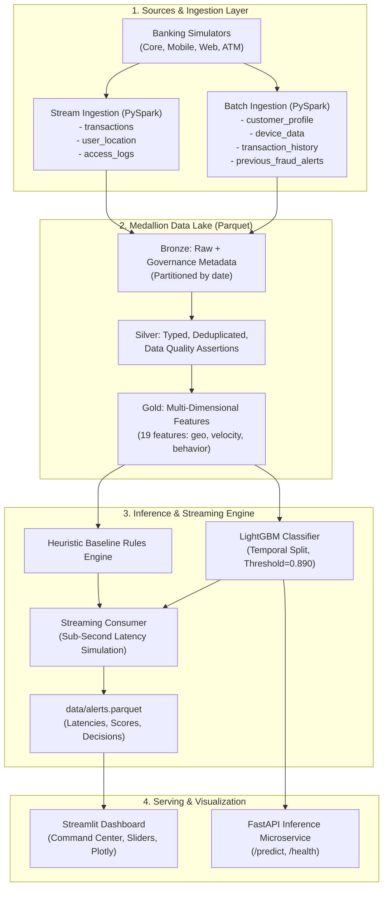

# System Architecture — Bank Fraud Detection Pipeline
**Datacycle · Unit 1 · Case 2: Retail Banking Real-Time Fraud Detection**

This document details the technical architecture, Medallion processing layers, and core components of the real-time fraud detection pipeline.

---

## 1. High-Level Architectural Overview

The system implements a decoupled event-driven architecture designed for real-time sub-second inference alongside batch analytical capabilities (hybrid Lambda/Kappa approach):

---

## 2. Medallion Storage Layers

| Layer | Path | Format | Technical Purpose & Governance |
|---|---|---|---|
| **Raw** | `data/raw/` | CSV, JSON, JSONL | Raw simulated source files emitted by core banking and mobile apps. |
| **Bronze** | `data/bronze/` | Parquet (Partitioned) | Immutable raw storage enriched with governance tags (`source_system`, `ingestion_timestamp`, `schema_version`, `data_classification`). |
| **Silver** | `data/silver/` | Parquet | Cleaned, deduplicated, and strictly typed tables validated by PySpark quality assertions. |
| **Gold** | `data/gold/` | Parquet | High-performance feature store table (`features.parquet`) ready for ML training and real-time inference. |
| **Alerts** | `data/alerts.parquet` | Parquet | Scored streaming transactions containing latencies, probabilities, heuristic outputs, and block decisions. |
| **Archive** | `data/archive/` | Compressed Parquet (ZSTD) | Cold compliance storage for audit and regulatory retention (5–10 years). |

---

## 3. Technology Stack

| Component | Technology | Technical Rationale |
|---|---|---|
| **Language** | Python 3.12 | Industry standard for AI, scientific computing, and big data engineering. |
| **Big Data Engine** | PySpark 3.5 | Distributed computing, scalable partitioning, and robust schema validation. |
| **Columnar Storage** | Apache Parquet / PyArrow | High compression ratio, fast columnar vectorization, and binary typing. |
| **Machine Learning** | LightGBM / Scikit-learn | High-throughput gradient boosted trees with native class weighting (`class_weight="balanced"`). |
| **Dashboard** | Streamlit + Plotly | Reactive web interface with live threshold sliders, financial cards, and pattern breakdowns. |
| **Serving API** | FastAPI + Pydantic + Uvicorn | Sub-millisecond REST microservice with typed contract validation. |
| **Testing & Quality** | Pytest | Complete 17-test automated verification suite covering schemas, leakage, and KPIs. |
| **Configuration** | PyYAML | Decoupled centralized configuration in `config/settings.yaml`. |
