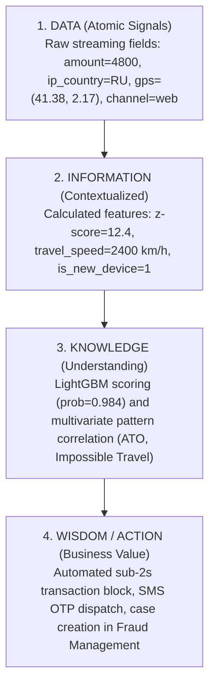

# The DIKW Pyramid in Real-Time Banking Fraud Detection
**Datacycle · Unit 1 · Case 2: Retail Banking Real-Time Fraud Detection**

The **DIKW** model (*Data, Information, Knowledge, Wisdom / Action*) conceptualizes the hierarchical transformation of raw, uncontextualized transactional bits into actionable, high-value business decisions.

---

## 1. The DIKW Pyramid in the Fraud Detection Pipeline



---

## 2. Level-by-Level Breakdown with Practical Case

### Level 1: Data
Objective, atomic, and uncontextualized data points captured from mobile apps, physical terminals, and transactional gateways:
- **Raw Transaction Payload**:
  ```json
  {
    "transaction_id": "tx-2004128",
    "customer_id": "c-100249",
    "amount": 4800.0,
    "currency": "EUR",
    "channel": "web",
    "device_id": "d-rogue-8a12",
    "event_timestamp": "2026-07-03T10:16:10Z",
    "ip_address": "185.12.4.9",
    "ip_country": "RU",
    "gps": {"lat": 41.3851, "lon": 2.1734}
  }
  ```
- **Property**: In isolation, this record does not indicate whether the operation is criminal or legitimate. It is simply an event transmitted across the wire.

---

### Level 2: Information
Achieved by joining raw records with **historical, relational, and spatial context**. In our Medallion architecture, this transformation occurs in the **Silver and Gold** layers without future leakage:
- **Customer Context (`customer_profile`)**: Customer `c-100249` averages 600 € monthly spend (~20 € daily baseline) and officially resides in Barcelona, Spain (`ES`).
- **Device Registry (`device_data`)**: Hardware identifier `d-rogue-8a12` has never been utilized by this user before (`is_new_device = 1`).
- **Geospatial Context (`geo.py`)**: IP address originates in Moscow (`RU`), while GPS telemetry reports Barcelona (`ES`). The computed geospatial discrepancy is **3,010 km** (`geo_distance_ip_gps_km = 3010.0`).
- **Velocity & Spending Ratios (`behavior.py`, `velocity.py`)**:
  - `amount_zscore_customer = 12.4` (12.4 standard deviations above customer mean).
  - `amount_to_spend_ratio = 8.0` (8× normal monthly spend).
  - `has_failed_login_history = 1` (4 failed login attempts detected in `access_logs` within the preceding 30 minutes).

---

### Level 3: Knowledge
Knowledge is the ability to **synthesize multivariate correlations, causal signals, and risk patterns**:
- **Pattern Synthesis**:
  - The simultaneous confluence of:
    1. Repeated failed authentication attempts followed by success from an unrecognized device.
    2. Exponentially anomalous transaction amount.
    3. Physically impossible geographical discrepancy.
  - Conclusively characterizes an **Account Takeover (ATO)** with **Impossible Travel**.
- **Statistical ML Inference (LightGBM)**:
  - The model computes an inference probability across 19 features:
    $$P(\text{is\_fraud} = 1 \mid \mathbf{x}) = 0.984$$
  - Exceeding the optimal decision threshold ($\theta = 0.890$), triggering a high-confidence alert.

---

### Level 4: Wisdom / Action (Business Value)
Wisdom is automated, risk-aware decision execution that balances capital preservation with customer convenience:
- **Sub-Second Real-Time Intervention ($< 2$ seconds)**:
  1. **Immediate Authorization Denial**: Payment is rejected before funds settle interbank.
  2. **Active Web Session Revocation**: Invalidate all active sessions on the unrecognized device to prevent further unauthorized attempts.
  3. **Out-of-Band Verification**: Dispatch SMS OTP or biometric challenge to the cardholder's verified mobile phone.
  4. **Case Creation**: Event logged to `data/alerts.parquet` with the full explainability payload.
- **Financial Bottom Line**:
  - **Capital Saved**: 4,800 € preserved in this single event; over 34,000 € saved across the evaluation stream.
  - **Avoided Dispute Costs**: Eliminates chargeback claims, dispute fees, and potential PSD2 penalties.
  - **Low Friction**: Precision above 97% ensures legitimate cardholders are virtually never falsely declined.
