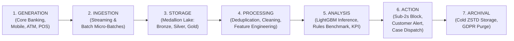

# The Data Lifecycle — Retail Banking Fraud Pipeline
**Datacycle · Unit 1 · Case 2: Retail Banking Fraud Detection**

This document details all 7 stages of the enterprise data lifecycle implemented in the real-time banking fraud detection platform, from event generation to regulatory cold archival.

---

## 1. End-to-End Data Lifecycle Diagram

---

## 2. Deep Dive: The 7 Stages

### Stage 1: Generation
- **Source Systems**:
  - High-fidelity synthetic banking simulators modeling realistic retail consumer spending, POS terminals, e-commerce, and mobile app interactions.
  - Deterministic reproducibility governed by `seed: 42`.
- **Injected Fraud Attack Vectors**:
  - `impossible_travel`: Rapid consecutive transactions separated by speed $> 800\text{ km/h}$.
  - `new_device_high_amount`: Unrecognized hardware executing amounts significantly exceeding the user's spending baseline.
  - `velocity_burst`: High-frequency bursts of 4 to 8 transactions in $< 10$ minutes (card testing / automated drains).
  - `account_takeover`: Failed credential brute forcing followed by authentication success from a new device and immediate transfer.
  - `foreign_country`: Transactions originating in unfamiliar jurisdictions.
  - `atm_nocturnal_drain`: Late-night ATM cash withdrawals at maximum account limits.
  - `phishing_mule_transfer`: Rapid funds evacuation toward money mule accounts.
  - `hard_subtle_fraud`: Camouflaged fraudulent transactions that mimic legitimate activity.

---

### Stage 2: Ingestion
- **Modes**:
  - **Streaming**: Live transactions (`transactions`), mobile telemetry (`user_location`), and authentication events (`access_logs`) ingested continuously.
  - **Batch**: Master customer records (`customer_profile`), hardware inventory (`device_data`), historical alerts (`previous_fraud_alerts`), and batch history (`transaction_history`).
- **Traceability Injection**:
  - Ingestion engines automatically append metadata: `source_system`, `ingestion_timestamp` (ISO-8601 UTC), and `schema_version`.

---

### Stage 3: Storage (Medallion Data Lake)
Decoupled Apache Parquet storage structured across three tiers:
1. **Bronze (`data/bronze/`)**: Immutable raw storage partitioned by date with full ingestion metadata.
2. **Silver (`data/silver/`)**: Cleaned, deduplicated, and strictly typed relational tables validated with PySpark quality assertions.
3. **Gold (`data/gold/`)**: Feature-engineered tabular store (`features.parquet`) with 19 multidimensional features ready for training and real-time lookup.

---

### Stage 4: Processing & Data Quality
- **Standardization**:
  - Strict UTC timestamp harmonization.
  - Primary key deduplication (`transaction_id`, `event_id`, `device_id`).
  - Handling of negative balances and physical GPS bounds ([-90, 90] lat, [-180, 180] lon).
- **Quality Gates**:
  - Null checks on critical identifiers (`customer_id`, `amount`, `event_timestamp`).
  - Referential integrity check (100% of transaction customers must exist in `customer_profile`).
- **Leakage-Free Feature Engineering**:
  - Rolling windows calculated strictly backward looking from `event_timestamp`.

---

### Stage 5: Analysis & Machine Learning Inference
- **Real-Time Scoring**:
  - Supervised **LightGBM Classifier** trained with temporal split and class weights.
  - Probability calibration and optimal decision threshold ($\theta = 0.890$).
- **Primary Lineage KPI**:
  $$\text{Real-Time Fraud \%} = \frac{\text{Frauds alerted with latency} \le N \text{ seconds}}{\text{Total verified frauds}} \times 100$$
  with $N = 2.0$ seconds.

---

### Stage 6: Action & Decisioning
- **Active Real-Time Intervention**:
  - If `is_alert == 1` and latency $\le 2s$, the transaction is intercepted before payment settlement.
  - Automatic push notification / SMS OTP challenge sent to the legitimate customer.
  - Security case logged to `data/alerts.parquet` with complete inference explanations.

---

### Stage 7: Archival & Regulatory Retention
- **Cold Storage**:
  - After 90 days, historical transactions are compacted and migrated to `data/archive/` using high-ratio **ZSTD** compression.
  - Regulatory retention policy of 5 to 10 years to comply with Anti-Money Laundering (AML) directives and central bank requirements.
  - Selective customer record purging supported for GDPR Right to Erasure compliance.
