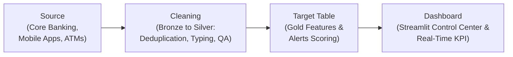
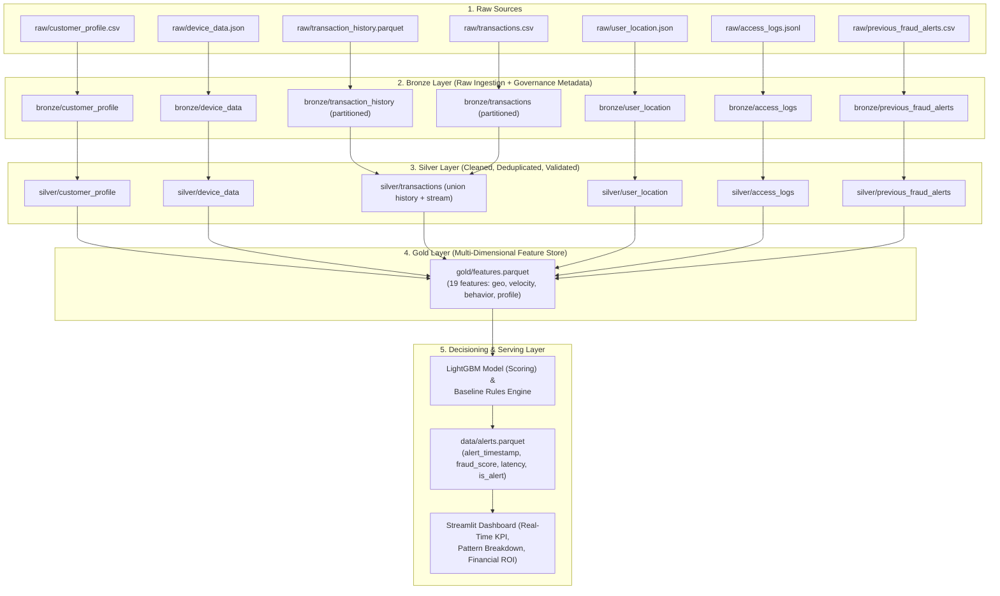

# Data Lineage & Traceability — Bank Fraud Detection Pipeline
**Datacycle · Unit 1 · Case 2: Retail Banking Real-Time Fraud Detection**

**Data lineage** defines the full life cycle, dependency flow, and transformation lineage from raw transactional sources to the live analytical and decisioning layers.

---

## 1. High-Level Lineage Flow

As defined in the course activity requirements, the primary flow follows four continuous stages:

---

## 2. Detailed Multi-Tier Lineage (Medallion Data Lake)

---

## 3. Column-Level Lineage Matrix

| Target Feature (Gold / Alerts) | Source Tables (Raw / Bronze) | Origin Columns | Transformation Logic / Algorithm |
|---|---|---|---|
| `geo_distance_ip_gps_km` | `user_location.json` | `ip_country`, `gps.lat`, `gps.lon` | Haversine formula measuring geospatial distance discrepancy between GPS sensor and IP address location. |
| `distance_from_home_km` | `transactions`, `customer_profile` | `gps.lat`, `gps.lon`, `home_lat`, `home_lon` | Orthodromic distance (in km) between the merchant/ATM location and customer's home address. |
| `travel_speed_kmh` | `transactions`, `user_location` | `gps.lat`, `gps.lon`, `event_timestamp` | $\Delta \text{distance} / \Delta \text{time}$ between consecutive transactions for the same customer. Detects impossible teleportation. |
| `amount_zscore_customer` | `transactions`, `transaction_history` | `customer_id`, `amount` | $( \text{amount} - \mu_{\text{customer}} ) / \sigma_{\text{customer}}$. Statistical normalization of spending deviation. |
| `txn_count_10min` | `transactions` | `customer_id`, `event_timestamp` | Rolling 10-minute count window (closed left) detecting rapid card-testing bursts. |
| `is_new_device` | `transactions`, `device_data` | `customer_id`, `device_id` | Join with customer's historical device registry. Flags `1` if device has never been seen before. |
| `has_failed_login_history` | `access_logs.jsonl` | `customer_id`, `event_type`, `event_timestamp` | Presence of recent `login_failed` events in the customer session history. |
| `detection_latency_seconds` | `transactions`, `consumer.py` | `event_timestamp`, `alert_timestamp` | $\text{alert\_timestamp} - \text{event\_timestamp}$. Total system latency from transaction dispatch to model score. |
| `real_time_fraud_pct` | `alerts.parquet` | `is_fraud`, `is_alert`, `detection_latency_seconds` | Primary business KPI: percentage of total verified frauds alerted within $N \le 2.0$ seconds. |

---

## 4. Traceability & Anti-Leakage Guarantees

1. **Strict Temporal Partitioning**:
   - `previous_fraud_alerts.csv` only contains transactions from the batch historical period (`2026-01-01` to `2026-06-30`). The automated unit test `test_no_data_leakage_in_previous_alerts` verifies zero ID overlap with streaming transactions.
2. **Backward-Looking Rolling Windows**:
   - Rolling feature calculations in `velocity.py` and `behavior.py` sort strictly by ascending timestamp and never access future transactions.
3. **Regulatory Audit Trail**:
   - Every row in `alerts.parquet` preserves `transaction_id`, timestamps, model score, latency, and ground truth for full regulatory traceability.
