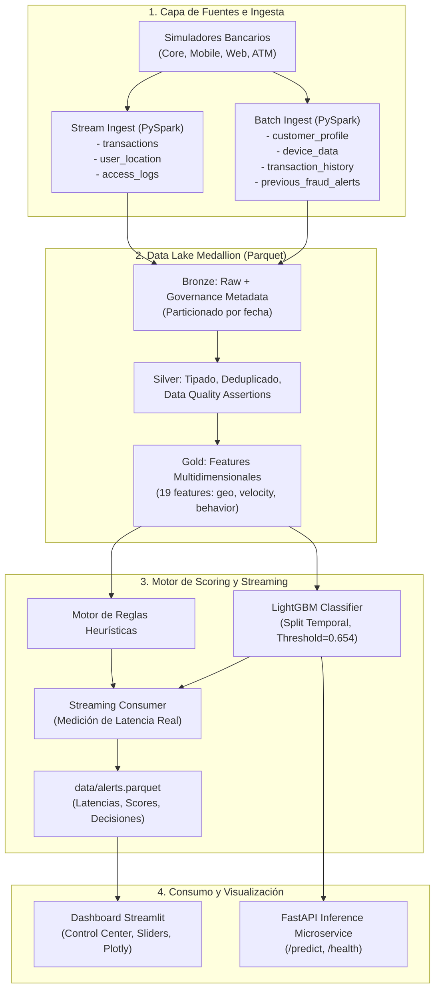

# Arquitectura del Sistema — Bank Fraud Detection Pipeline
**Datacycle · Unidad 1 · Caso 2: Retail Banking Real-Time Fraud Detection**

Este documento detalla la arquitectura técnica, las capas de procesamiento Medallion y los componentes del pipeline en tiempo real.

---

## 1. Visión General de la Arquitectura

El sistema implementa una arquitectura desacoplada orientada a eventos para el procesamiento en tiempo real con soporte analítico en lote (arquitectura híbrida Lambda/Kappa):

---

## 2. Capas de Almacenamiento Medallion

| Capa | Ruta | Formato | Propósito y Contenido |
|---|---|---|---|
| **Raw** | `data/raw/` | CSV, JSON, JSONL | Datos crudos tal como salen de los generadores y sistemas bancarios simulados. |
| **Bronze** | `data/bronze/` | Parquet (particionado) | Ingesta inmutable con metadatos de gobernanza (`source_system`, `ingestion_timestamp`, `schema_version`, `data_classification`). |
| **Silver** | `data/silver/` | Parquet | Tablas limpias, con tipado estricto, deduplicación de IDs y validación de reglas de calidad. |
| **Gold** | `data/gold/` | Parquet | Tabla analítica de características multidimensionales (`features.parquet`) optimizada para entrenamiento e inferencia. |
| **Alerts** | `data/alerts.parquet` | Parquet | Histórico de transacciones evaluadas en tiempo real con latencia, probabilidad y decisión de alerta. |
| **Archive** | `data/archive/` | Parquet comprimido (ZSTD) | Almacenamiento frío para auditoría regulatoria y retención legal a 5-10 años. |

---

## 3. Stack Tecnológico

| Componente | Tecnología | Justificación de Selección |
|---|---|---|
| **Lenguaje** | Python 3.12 | Estándar de la industria para IA, ciencia de datos e ingeniería de datos. |
| **Procesamiento Big Data** | PySpark 3.5 | Procesamiento distribuido escalable, particionamiento eficiente y compatibilidad Hadoop. |
| **Almacenamiento Columnar** | Apache Parquet / PyArrow | Alta compresión, lectura rápida orientada a columnas y tipado binario seguro. |
| **Machine Learning** | LightGBM / Scikit-learn | Árboles de gradiente ultrarrápidos con balanceo de clases asimétricas (`class_weight="balanced"`). |
| **Dashboard y Visualización** | Streamlit + Plotly | Cuadros de mando interactivos en tiempo real con componentes dinámicos y gráficos avanzados. |
| **Serving API** | FastAPI + Pydantic + Uvicorn | Microservicio REST de alto rendimiento con validación de esquemas tipados. |
| **Testing y Calidad** | Pytest | Batería de 17 tests unitarios automatizados que verifican extremo a extremo el pipeline. |
| **Configuración** | PyYAML | Configuración desacoplada en `config/settings.yaml` sin parámetros quemados en código. |
