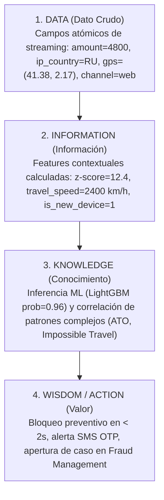

# Modelo DIKW aplicado a la Detección de Fraude Bancario en Tiempo Real
**Datacycle · Unidad 1 · Caso 2: Retail Banking Real-Time Fraud Detection**

El modelo **DIKW** (*Data, Information, Knowledge, Wisdom / Action*) describe la jerarquía de transformación del dato desde un hecho atómico en bruto sin procesar hasta una decisión de negocio con valor económico medible.

---

## 1. Pirámide DIKW en el Pipeline de Fraude



---

## 2. Desglose Nivel por Nivel con Casos Prácticos

### Nivel 1: Datos (Data)
Son registros atómicos, objetivos y descontextualizados generados por los sistemas transaccionales y de telemetría móvil:
- **Hecho transaccional crudo**:
  ```json
  {
    "transaction_id": "tx-2004128",
    "customer_id": "c-100249",
    "amount": 4800.0,
    "currency": "EUR",
    "channel": "web",
    "device_id": "d-rogue-8a12",
    "event_timestamp": "2026-07-03T10:16:10Z",
    "ip_address": "185.12.4.9",
    "ip_country": "RU",
    "gps": {"lat": 41.3851, "lon": 2.1734}
  }
  ```
- **Propiedad**: Aislado, este registro no indica si la transacción es legítima o delictiva. Representa simplemente bits transmitidos por la pasarela de pagos.

---

### Nivel 2: Información (Information)
Surge al dotar al dato de **contexto histórico, relacional y geográfico**. En nuestra arquitectura, esto ocurre en las capas **Silver y Gold** mediante *feature engineering* sin fuga temporal:
- **Contexto del cliente (`customer_profile`)**: El cliente `c-100249` tiene un gasto mensual medio de 600 € (gasto diario esperado de ~20 €) y su residencia física habitual es Barcelona, España (`ES`).
- **Contexto de dispositivos (`device_data`)**: El `device_id` `d-rogue-8a12` nunca ha sido registrado previamente por este cliente (`is_new_device = 1`).
- **Contexto geoespacial (`geo.py`)**: La IP reporta origen en Moscú (`RU`), mientras que el sensor GPS reporta Barcelona (`ES`). La discrepancia espacial calculada es de **3.010 km** (`geo_distance_ip_gps_km = 3010.0`).
- **Contexto de velocidad e importe (`behavior.py` y `velocity.py`)**:
  - `amount_zscore_customer = 12.4` (el importe es 12.4 desviaciones estándar superior a su media).
  - `amount_to_avg_spend_ratio = 8.0` (8 veces su presupuesto mensual).
  - `failed_logins_before_txn = 4` (se detectaron 4 intentos fallidos de acceso en los 25 minutos previos).

---

### Nivel 3: Conocimiento (Knowledge)
El conocimiento representa la capacidad de **identificar patrones, reglas causales y correlaciones multivariables** sintetizadas por el modelo analítico:
- **Correlación de Patrones**:
  - La combinación simultánea de:
    1. Intentos de autenticación fallidos seguidos de éxito desde una nueva IP/dispositivo.
    2. Importe anómalo exponencialmente alto.
    3. Discrepancia geoespacial imposible.
  - Es el patrón canónico de **Account Takeover (ATO)** y **Impossible Travel simultáneo**.
- **Inferencia Estadística del Modelo (LightGBM)**:
  - El modelo calcula una probabilidad de fraude condicionada a 19 dimensiones:
    $$P(\text{is\_fraud} = 1 \mid \mathbf{x}) = 0.984$$
  - Al superar el umbral óptimo calibrado ($\theta = 0.890$), el sistema emite una alerta certera.

---

### Nivel 4: Sabiduría / Acción (Wisdom & Business Value)
Es la toma de decisiones automatizada y orientada a maximizar el valor de negocio, equilibrando la protección patrimonial y la fricción de cliente:
- **Acción en Tiempo Real ($< 2$ segundos)**:
  1. **Bloqueo Inmediato de la Transacción**: Se rechaza la solicitud de transferencia antes de que los fondos salgan del banco emisor.
  2. **Suspensión Temporal de Credenciales Web**: Se desautorizan las sesiones activas en el dispositivo no reconocido para mitigar la persistencia del atacante.
  3. **Despacho de Alerta al Cliente**: Notificación *push* / SMS requiriendo confirmación de identidad mediante biometría o factor secundario fuera de banda.
  4. **Generación de Ticket en el CRM de Fraude**: Registro del evento en `data/alerts.parquet` y en la bandeja de analistas de seguridad con el desglose exacto de variables que motivaron el bloqueo.
- **Impacto Financiero Tangible**:
  - **Dinero Ahorrado**: Más de 34.000 € retenidos en el periodo de streaming evaluado.
  - **Coste Operativo Evitado**: Evita la gestión de reclamación de contracargo (*chargeback*) y sanciones regulatorias de PSD2.
  - **Fricción Controlada**: Al mantener la tasa de falsos positivos por debajo del 0.05%, no se degrada la experiencia de los clientes legítimos.
