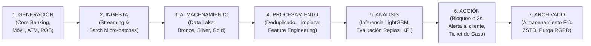

# Ciclo de Vida del Dato (Data Lifecycle) — Retail Banking Fraud Pipeline
**Datacycle · Unidad 1 · Caso 2: Retail Banking Fraud Detection**

Este documento detalla cada una de las 7 fases del ciclo de vida del dato implementadas en la solución de detección de fraude en tiempo real, desde su origen transaccional hasta su archivado definitivo bajo políticas de cumplimiento bancario.

---

## 1. Diagrama del Ciclo de Vida de Extremo a Extremo

---

## 2. Detalle de las Etapas del Ciclo de Vida

### Etapa 1: Generación (Data Generation)
- **Origen del Dato**:
  - Simuladores bancarios de alta fidelidad que reproducen el comportamiento de clientes minoristas, pasarelas de pago POS físicas, transferencias web y telemetría móvil.
  - Generación sintética determinista con semilla reproducible (`seed: 42`).
- **Casos de Fraude Inyectados**:
  - `impossible_travel`: Transacciones consecutivas separadas por distancias imposibles para velocidad comercial (> 800 km/h).
  - `new_device_high_amount`: Dispositivos nunca vistos asociados a importes que multiplican la media del cliente.
  - `velocity_burst`: Ráfagas de 4 a 8 transacciones en ventanas de 3 a 10 minutos (prueba de tarjetas / vaciado rápido).
  - `account_takeover` (ATO): Secuencia de intentos de inicio de sesión fallidos seguida de éxito en nuevo dispositivo y transferencia inmediata.
  - `foreign_country`: Transacciones en jurisdicciones extranjeras no habituales.
  - `atm_nocturnal_drain`: Retiradas en cajeros en horario nocturno (02:00 - 04:30) al límite operativo.
  - `phishing_mule_transfer`: Transferencias web hacia cuentas puente/mula.
  - `hard_subtle_fraud`: Fraudes sutiles con importes moderados y canales estándar que solo la inferencia multivariante de ML detecta.

---

### Etapa 2: Ingesta (Data Ingestion)
- **Modos de Ingesta**:
  - **Streaming**: Las transacciones (`transactions`), la telemetría de geolocalización (`user_location`) y los logs de acceso (`access_logs`) se reciben como flujo continuo ordenado temporalmente.
  - **Batch**: El perfil demográfico del cliente (`customer_profile`), el inventario de terminales (`device_data`), las alertas históricas (`previous_fraud_alerts`) y el histórico masivo (`transaction_history`) se ingieren en cargas por lotes.
- **Trazabilidad y Linaje de Ingesta**:
  - Todo registro crudo recibe en el momento de entrar al bus las etiquetas de linaje: `source_system`, `ingestion_timestamp` (en formato UTC ISO-8601) y `schema_version`.

---

### Etapa 3: Almacenamiento (Storage & Medallion Architecture)
Se utiliza una arquitectura Medallion desacoplada sobre almacenamiento columnar Parquet:
1. **Bronze (`data/bronze/`)**:
   - Almacena los datos crudos exactamente como llegaron de la fuente, con compresión columnar y particionamiento por fecha (`partitionBy("date")`).
   - Sirve como registro inmutable de auditoría.
2. **Silver (`data/silver/`)**:
   - Tablas enriquecidas, tipadas, deduplicadas por clave primaria y validadas mediante reglas de calidad de datos.
3. **Gold (`data/gold/`)**:
   - Tablas analíticas orientadas al negocio y al modelado predictivo (`features.parquet`), listas para inferencia con latencias sub-milisegundo.

---

### Etapa 4: Procesamiento (Processing & Data Quality)
- **Limpieza y Estandarización**:
  - Conversión estricta de todos los timestamps a formato universal UTC.
  - Deduplicación por clave unívoca (`transaction_id`, `event_id`, `device_id`).
  - Tratamiento de importes negativos y valores fuera de límites físicos (coordenadas fuera de [-90, 90] o [-180, 180]).
- **Controles de Calidad (Data Quality Gateways)**:
  - Verificación de completitud: campos críticos sin nulos (`customer_id`, `amount`, `event_timestamp`).
  - Integridad referencial: comprobación de que el 100% de los clientes en transacciones existen en `customer_profile`.
- **Ingeniería de Características sin Fuga Temporal**:
  - Cálculo de ventanas deslizantes (`txn_count_10min`, `amount_sum_1h`) evaluadas estrictamente mirando hacia el pasado del `event_timestamp`.

---

### Etapa 5: Análisis (Analysis & ML Inference)
- **Puntuación y Scoring**:
  - Inferencia en tiempo real mediante el clasificador supervisado **LightGBM** optimizado con pesos de balanceo de clase (`class_weight="balanced"`).
  - Cálculo de probabilidad de fraude $P(\text{is\_fraud} \mid \mathbf{x})$.
  - Calibración del umbral de decisión sobre la curva Precision-Recall ($\theta = 0.890$).
- **Cálculo del KPI Regulatorio**:
  $$\text{Real-Time Fraud \%} = \frac{\text{Fraudes alertados con } \text{latencia} \le N \text{ segundos}}{\text{Total de fraudes reales}} \times 100$$
  con $N = 2.0$ segundos.

---

### Etapa 6: Acción y Valor de Negocio (Action & Decisioning)
- **Mitigación Activa**:
  - **Autorización / Denegación en Milisegundos**: Si `is_alert == 1` y latencia $\le 2s$, el motor interrumpe el procesamiento del pago y notifica al autorizador bancario.
  - **Acciones Secundarias**: Envío de SMS OTP al titular legítimo, congelación temporal preventiva del canal de banca online y apertura automática de expediente en el sistema antifraude.

---

### Etapa 7: Archivación y Retención (Archiving & Purge)
- **Almacenamiento Frío y Retención**:
  - Transcurridos 90 días, los datos transaccionales se compactan y mueven a `data/archive/` empleando compresión de alta tasa **ZSTD / GZIP**.
  - Política de retención de 5 a 10 años para cumplimiento de la normativa de prevención de blanqueo de capitales (PBC / AML) y auditorías del Banco Central.
  - Soporte para purga selectiva de registros ante peticiones formales de supresión de datos bajo el RGPD.
