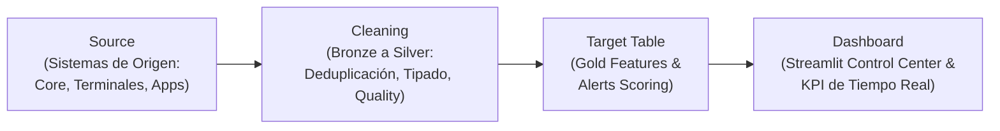
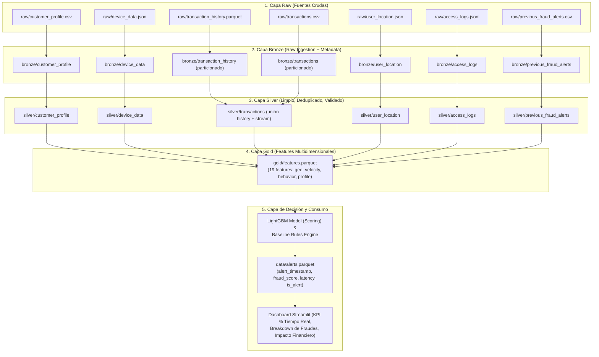

# Linaje del Dato (Data Lineage) — Bank Fraud Detection Pipeline
**Datacycle · Unidad 1 · Caso 2: Retail Banking Real-Time Fraud Detection**

El **linaje del dato** describe la trazabilidad completa, el ciclo de vida de transformaciones y el flujo de dependencias desde las fuentes transaccionales originales hasta los paneles analíticos de control en tiempo real.

---

## 1. Flujo Simplificado de Linaje (Requisito de la Actividad)

Tal como solicita el enunciado de la actividad formativa, el flujo fundamental se define en cuatro fases continuas:

---

## 2. Linaje Detallado Multi-Capa (Arquitectura Medallion)

El pipeline integra los 7 datasets a través de las capas de refinamiento progresivo:

---

## 3. Matriz de Linaje a Nivel de Columna (Column-Level Lineage)

La siguiente tabla traza la procedencia y transformación de las variables críticas:

| Variable Destino (Gold / Alerts) | Tabla Origen (Raw / Bronze) | Columnas de Origen | Lógica de Transformación / Algoritmo |
|---|---|---|---|
| `geo_distance_ip_gps_km` | `user_location.json` | `ip_country`, `gps.lat`, `gps.lon` | Fórmula de Haversine calculando la discrepancia geográfica entre la coordenada GPS y la geolocalización IP. |
| `distance_from_home_km` | `transactions`, `customer_profile` | `gps.lat`, `gps.lon`, `home_lat`, `home_lon` | Distancia ortodrómica en km entre el punto de venta/dispositivo y el domicilio oficial registrado del cliente. |
| `travel_speed_kmh` | `transactions`, `user_location` | `gps.lat`, `gps.lon`, `event_timestamp` | $\Delta \text{distancia} / \Delta \text{tiempo}$ entre transacciones consecutivas del mismo cliente. Detecta teleportación o viaje imposible. |
| `amount_zscore_customer` | `transactions`, `transaction_history` | `customer_id`, `amount` | $( \text{amount} - \mu_{\text{customer}} ) / \sigma_{\text{customer}}$. Normalización estadística del desvío de consumo individual. |
| `txn_count_10min` | `transactions` | `customer_id`, `event_timestamp` | Conteo en ventana temporal deslizante de 10 minutos (cerrada a la izquierda) para detectar ráfagas de prueba de tarjetas. |
| `is_new_device` | `transactions`, `device_data` | `customer_id`, `device_id` | Cruce con el catálogo histórico de dispositivos del cliente. Asigna `1` si el dispositivo no estaba previamente registrado. |
| `has_failed_login_history` | `access_logs.jsonl` | `customer_id`, `event_type`, `event_timestamp` | Presencia de eventos `login_failed` en el historial de sesión previo a la transacción. |
| `detection_latency_seconds` | `transactions`, `consumer.py` | `event_timestamp`, `alert_timestamp` | $\text{alert\_timestamp} - \text{event\_timestamp}$. Tiempo total transcurrido desde la emisión del pago hasta la decisión del modelo. |
| `real_time_fraud_pct` | `alerts.parquet` | `is_fraud`, `is_alert`, `detection_latency_seconds` | Métrica agregada de negocio: porcentaje de fraudes confirmados alertados con latencia $\le 2.0$ segundos. |

---

## 4. Garantías de Trazabilidad y Prevención de Data Leakage

1. **Partición Temporal Estricta**:
   - Las alertas previas (`previous_fraud_alerts.csv`) solo referencian transacciones del periodo histórico (`2026-01-01` a `2026-06-30`). El test automatizado `test_no_data_leakage_in_previous_alerts` garantiza que la intersección de identificadores de transacción con el periodo de streaming es nula (`len == 0`).
2. **Ventanas Deslizantes sin Mirada al Futuro**:
   - Todas las funciones de ventana en `velocity.py` y `behavior.py` ordenan estrictamente por `event_timestamp` ascendente y solo acumulan información pasada, garantizando que el modelo sea fiel al entorno de producción en tiempo real.
3. **Auditoría Regulatoria**:
   - Cada registro en la capa final `alerts.parquet` retiene el `transaction_id`, el timestamp de evento, el timestamp de decisión y el `fraud_score`, permitiendo reproducir y justificar cualquier bloqueo transaccional ante auditorías del Banco de España o el BCE.
