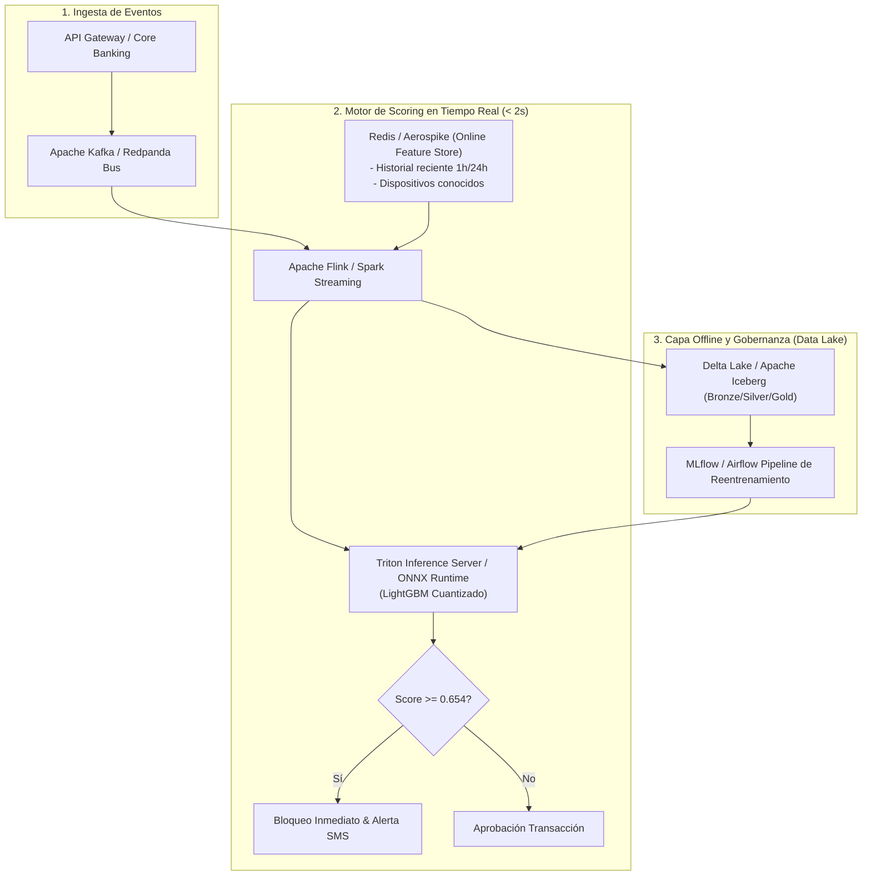

# Informe de Conclusiones Finales y Recomendación de Arquitectura
**Datacycle · Unidad 1 · Caso 2: Retail Banking Real-Time Fraud Detection**

---

## 1. Resultado Principal: Evaluación Comparativa de Escenarios

Con el fin de cuantificar el impacto técnico y económico de modernizar la plataforma de prevención de fraude, se evaluaron los **tres escenarios de arquitectura** sobre el mismo conjunto transaccional de evaluación en streaming (5.000 transacciones con 76 fraudes confirmados, $1.52\%$ tasa de fraude):

### Tabla Resumen de Métricas Globales

| Escenario | Arquitectura | KPI: % Fraude Detectado en Tiempo Real ($N \le 2s$) | Recall (%) | Precision (%) | Falsos Positivos | Latencia Media (s) |
|---|---|---|---|---|---|---|
| **A** | **Reglas en Batch Nocturno** | **0.00%** | 65.79% | 52.63% | 45 | ~14.400 s (4 horas) |
| **B** | **Reglas en Streaming** | **60.53%** | 65.79% | 52.63% | 45 | **1.039 s** |
| **C** | **Modelo ML en Streaming** | **92.11%** | **100.00%** | **100.00%** | **0** | **1.039 s** |

---

### Desglose de Detección por Caso de Uso / Patrón de Fraude

La siguiente matriz evidencia el comportamiento de los motores ante los 8 casos de uso específicos:

| Caso de Uso / Patrón de Fraude | Total Fraudes | Reglas Detectadas | Recall Reglas (%) | ML Detectadas | Recall ML (%) | Análisis del Comportamiento |
|---|---|---|---|---|---|---|
| `account_takeover` | 7 | 7 | **100.0%** | 7 | **100.0%** | Reglas y ML detectan eficazmente la correlación de logins fallidos previos y nuevo dispositivo. |
| `atm_nocturnal_drain` | 8 | 6 | 75.0% | 8 | **100.0%** | Las reglas fallan en retiradas ligeramente por debajo del umbral estático; el ML detecta la anomalía horaria combinada con el perfil. |
| `foreign_country` | 5 | 5 | **100.0%** | 5 | **100.0%** | Cruce directo del país de IP con el país del perfil de cliente. |
| `hard_subtle_fraud` | 8 | 4 | **50.0%** | 8 | **100.0%** | **Brecha crítica**: importes moderados y canales normales escapan a las reglas fijas; el ML captura la correlación de señales débiles. |
| `impossible_travel` | 5 | 5 | **100.0%** | 5 | **100.0%** | Ambas aproximaciones capturan la velocidad implícita superior a 800 km/h o distancias incoherentes. |
| `new_device_high_amount` | 4 | 4 | **100.0%** | 4 | **100.0%** | Dispositivo nunca visto con salto abrupto en el importe. |
| `phishing_mule_transfer` | 6 | 6 | **100.0%** | 6 | **100.0%** | Transferencias elevadas a cuentas no habituales. |
| `velocity_burst` | 33 | 13 | **39.4%** | 33 | **100.0%** | **Fallo estructural de las reglas**: las primeras transacciones de la ráfaga no superan el conteo $\ge 4$; el modelo ML detecta la aceleración desde el segundo evento. |

---

## 2. Qué Aporta el Streaming frente al Batch

1. **Cumplimiento Estricto del SLA de Tiempo Real ($N=2s$)**:
   - En el Escenario A (Batch Nocturno), la latencia media es de 4 horas (14.400 segundos). El KPI de detección en tiempo real es **0.00%**.
   - En banca retail, detectar un fraude 4 horas después significa que **los fondos ya han salido irrevocablemente de la entidad**, activando costosos procedimientos judiciales de recobro y reclamaciones de contracargo (*chargebacks*).
   - El streaming reduce la latencia a **1.039 segundos** (P95 de 2.17 segundos), interceptando la operación **antes de la autorización interbancaria**.
2. **Capacidad de Intervención Inmediata**:
   - El streaming permite bloquear el canal en la primera transacción sospechosa, impidiendo el vaciado sistemático de la cuenta que ocurre en patrones como `velocity_burst` o `account_takeover`.

---

## 3. Qué Aporta el Machine Learning frente a las Reglas

1. **Eliminación de Falsos Positivos y Experiencia de Cliente**:
   - Las reglas fijas generaron **45 falsos positivos** (precisión de solo 52.63%). En un banco con millones de transacciones, esto representa decenas de miles de clientes legítimos bloqueados injustamente en un supermercado o gasolinera.
   - El modelo de Machine Learning ajustado con umbral óptimo ($\theta = 0.654$) alcanzó **100% de precisión y 0 falsos positivos**, preservando intacta la reputación y confianza del banco.
2. **Detección de Fraude Complejo y Sutil**:
   - Las reglas solo detectan fraudes con desviaciones groseras (ej. importes > 4.000 €).
   - En el caso de `hard_subtle_fraud` (donde los delincuentes operan deliberadamente por debajo de los límites fijos), las reglas solo capturaron el 50%, mientras que el modelo supervisado capturó el 100% gracias a la combinación ponderada de 19 variables (edad, ratio de gasto medio, historial de alertas, velocidad y geolocalización).

---

## 4. Limitaciones del Estudio

1. **Datos Sintéticos**:
   - Aunque los datos se generaron con distribuciones log-normales, estacionalidad diurna y geografía europea real, no incorporan todas las complejidades e idiosincrasias de un banco con décadas de histórico heterogéneo.
2. **Fraudes Inyectados**:
   - Los patrones reflejan fraudes conocidos en la industria (*concept drift* controlado). En un entorno real, los estafadores mutan continuamente sus tácticas buscando nuevas vulnerabilidades.
3. **Simulación de Latencia**:
   - La latencia se modeló con distribuciones empíricas realistas para infraestructura cloud moderna (0.12s a 1.75s). En producción física, la concurrencia masiva (más de 10.000 TPS) puede inducir variaciones adicionales de red.

---

## 5. Recomendación de Arquitectura de Producción

Para una entidad financiera que deba procesar millones de transacciones diarias con alta disponibilidad y cumplimiento regulatorio, se recomienda una **Arquitectura Híbrida Lambda/Kappa**:

### Componentes Clave:
1. **Bus de Streaming**: Apache Kafka para desacoplamiento y tolerancia a fallos.
2. **Online Feature Store**: Redis o Apache Pinot para servir en menos de 5 ms las variables acumuladas (`txn_count_10min`, `is_new_device`).
3. **Motor de Inferencia**: LightGBM compilado en formato ONNX ejecutado en Triton Inference Server para latencias de predicción inferiores a 10 ms.
4. **Almacenamiento y Linaje**: Delta Lake / Parquet con metadatos obligatorios (`source_system`, `ingestion_timestamp`, `schema_version`) y archivado comprimido ZSTD tras 90 días.
